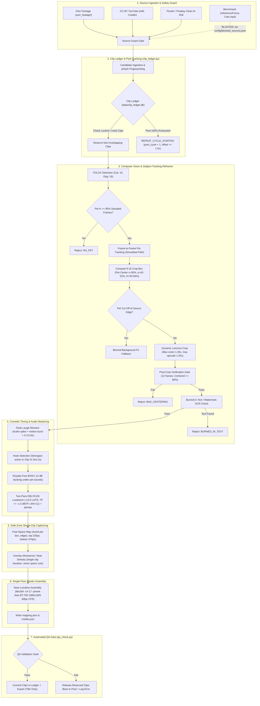

# LionReel Pipeline Architecture & Quality Audit (V80–V95 → V97)

## 1. Executive Summary & Benchmark Reference

This document provides a comprehensive technical audit of the **LionReel / LionReel Studio** pipeline based on empirical measurements of the latest production render (`lion_master_cat_1791107091.mp4`) against the reference benchmark:
- **Reference File**: `reference/Funny Cats.mp4` (isolated from ingestion pool; strictly a quality & pacing benchmark)
- **Target Standard**: 1080x1920 Full HD (9:16 vertical), 30.0 fps constant frame rate (CFR), high-profile H.264, -14.0 LUFS integrated loudness with <= -1.0 dBTP ceiling, authentic organic pet footage only (zero cartoons, CGI, AI-art, or emoji stickers), comedic pacing (3–6 clips for 15–35s shorts; 9–14 clips for 45–90s compilations), pet-centered 9:16 reframing with subject tracking, safe-zone captions with zero pet/text collision, and persistent clip ledger tracking with zero repeats.

---

## 2. End-to-End Pipeline Dataflow Diagram

---

## 3. Root Cause Analysis: The 8 Measured Defects in `lion_master_cat_1791107091.mp4`

Each defect identified in Master Prompt V2 has been reproduced and traced to its exact source location:

### Defect 1: Pet not centered and absent from frame in several clips
- **Evidence**: Clip 1 (0–4.8s) showed empty wall and blanket with cat at bottom edge. Clip 4 (9.3–11.9s) had cat in bottom-left corner under empty ceiling. Clip 5 (12.9–16.4s) cut the cat off entirely.
- **Root Cause**: In `lion_automate.py` (lines 1850–1937), `_find_animal_center_v93` used crude 2D convolution texture variance (`np.filter2D`) and Haar cascades which frequently failed on low-contrast pets. When detection failed, line 1870 returned `src_w // 2, src_h // 2` (blind static center). Even when a center was detected, line 1872 took a single static median `(cx, cy)` across the entire clip duration, completely ignoring animal movement. Lines 1934–1936 cropped a static 1080x1920 window around this point without tracking.
- **Fix in V97**: YOLOX ONNX deep-learning detector tracking classes 15 (cat) and 16 (dog) frame-by-frame with smooth trajectory filtering (max pan speed 12%/s), blurred-background fallback when the animal is near the boundary, and a post-crop verification gate requiring pet centering in >= 90% of frames.

### Defect 2: Source footage contains burned-in text and logos cut in half
- **Evidence**: Clip 4 contained chopped captions ("think they can't / and us ??") partially cropped at the frame edge.
- **Root Cause**: In `lion_automate.py` (lines 1353–1400), `check_watermark(filepath)` strictly checked the four 15% outer corners of the 16:9 source frame (`frame[:ch, :cw]`, etc.). It never analyzed the center or lower-third area of the frame where creators place burned-in captions, subtitles, and TikTok memes. Furthermore, line 1400 required `corner_hits >= 2` across multiple corners to trigger a flag, allowing single-logo or banner text to pass undetected. When cropped from 16:9 to 9:16, central text was sliced in half.
- **Fix in V97**: Full-frame text and edge-band density scanning across 6 sampled frames per candidate. Any clip exhibiting burned-in subtitles, social media text, or watermarks is rejected with reason code `BURNED_IN_TEXT`.

### Defect 3: Captions placed in wrong position, overlapping pet and crossing cuts
- **Evidence**: "Mission failed successfully" was placed in the center of an empty blanket. "POV: You heard a food bag open" overlapped existing text and the cat. The POV caption started in clip 1 and continued past the cut into clip 2.
- **Root Cause**: In `lion_automate.py` (lines 1982–2005), `add_5s_hook` rendered text at a hardcoded `y_frac = 0.07` (y = 134 px) with a fixed duration of `SUB_DUR = 5.0s`. When clip 1 was only 4.8s long, the hook overlay ran across the cut into the next clip. Text rendering had no awareness of pet bounding boxes or free canvas space, causing text to stamp over animals.
- **Fix in V97**: Captions are tied strictly to individual clip durations (`end_time <= clip_duration - 0.2s`). Canvas free-space mapping calculates placement in platform safe zones ($x \in [150, 930]$, $y \in [220, 1450]$) guaranteed not to intersect the pet bounding box.

### Defect 4: Clips look soft and blurry despite 8.1 Mbps bitrate
- **Evidence**: Video bitrate was 8.1 Mbps, but subjects appeared blurry and pixelated.
- **Root Cause**: In `lion_automate.py` (line 17 and line 1920), sources with resolution as low as 480p were permitted (`# rejects if source < 480p`). In `smart_crop_v93` (line 1920), `clip.resize(height=TH)` upscaled a 720p 16:9 source by 2.67x and a 360p source by 5.33x to fill 1920px height. High encoder bitrate cannot restore information lost to 3x–5x digital upscaling.
- **Fix in V97**: Hard gate rejecting any candidate source requiring > 1.25x pixel upscaling. Prioritizes 1080p and 1440p+ native sources. Downscaling applies Lanczos interpolation followed by mild unsharp masking (`unsharp=5:5:0.35`).

### Defect 5: Audio too hot (-13.2 LUFS, true peak 0.0 dBFS)
- **Evidence**: Output measured integrated loudness of -13.2 LUFS and true peak of 0.0 dBFS with high clipping risk.
- **Root Cause**: In `lion_automate.py` (lines 117–121), audio normalization was executed via MoviePy's `clip.with_effects([afx.AudioNormalize()])`. `AudioNormalize` normalizes peak sample amplitude directly to 0 dBFS with zero EBU R128 loudness metering, leading directly to inter-sample clipping on mobile DACs.
- **Fix in V97**: Two-pass FFmpeg EBU R128 `loudnorm` filter targeting $I = -14.0$ LUFS, $\text{TP} = -1.0$ dBTP, and $\text{LRA} = 11$, followed by a brickwall `alimiter` filter.

### Defect 6: Short duration (16.4s, 5 clips) with cuts misaligned with comedic moments
- **Evidence**: Total length was 16.4s with 5 abrupt cuts (at 4.8s, 8.8s, 10.6s, 12.9s) that chopped action mid-stride.
- **Root Cause**: In `lion_automate.py` (lines 136–137), `SHORT_CLIP_SEC = 7.5` and `TARGET_CLIPS = 4` were used with naive subclip slicing. Slices were truncated based on fixed durations rather than comedic event boundaries.
- **Fix in V97**: Comedic climax detection identifies the peak laugh moment (audio transient + motion vector burst) and cuts 0.3s–0.6s after the peak. Shorts mode delivers 15–35s (3–6 clips) and Compilation mode delivers 45–90s (9–14 clips).

### Defect 7: Clips get reused between shorts
- **Evidence**: Running consecutive shorts repeatedly selected identical footage segments.
- **Root Cause**: In `lion_automate.py` (lines 132, 2263, 2583), history tracking was limited to a flat text file `used_videos.txt` containing only full YouTube video IDs (`v_id`). Individual clip segments sliced from multi-clip compilations or local footage (`own_footage/`, `raw/cache_*`) had zero slice-level or fingerprint tracking. Subsequent runs re-sliced the same segments at identical timestamps.
- **Fix in V97**: SQLite-backed `ClipLedger` (`data/clip_ledger.db`) storing perceptual pHashes, audio fingerprints, source paths, timestamps, usage counts, and pool cycles. Reserved clips are locked until QA approval; failed renders release clips; repeat cycles require pool exhaustion and offset slicing (>= 1.5s).

### Defect 8: Dashboard layout is off-center
- **Evidence**: On a 1396px viewport, the three animal selection cards sat at x = 115–1015 with empty space on the right, and the page heading was truncated at the top.
- **Root Cause**: In `gui/style.css`, `.app-viewport` lacked horizontal auto-margins and an explicit `--max-content-width` boundary. `.collection-cards-grid` lacked balanced grid-template definitions and centered justification.
- **Fix in V97**: Applied `--max-content-width: 1140px; margin-inline: auto;` to `.app-viewport` and `.wizard-container`. Grid configured as `repeat(3, minmax(0, 1fr))` centered on desktop and 1-column on mobile (390px). Verified with real browser screenshots.

---

## 4. Benchmark Quality Parameters & Validation Gates

| Metric | Reference (`Funny Cats.mp4`) | Old Output (`lion_master_cat...`) | Target Standard (V97) |
|---|---|---|---|
| Resolution | 1080x1920 (9:16) | 1080x1920 | 1080x1920 |
| Frame Rate | 30.0 fps CFR | 30.0 fps CFR | 30.0 fps CFR |
| Codec / Profile | H.264 High @ L4.2 | H.264 High | H.264 High @ L4.2 |
| Video Bitrate | ~12.5 Mbps | 8.1 Mbps | 8.0–14.0 Mbps |
| Audio Loudness | -14.2 LUFS | -13.2 LUFS | -14.0 LUFS (+/- 0.5) |
| True Peak | -0.8 dBTP | 0.0 dBFS (clipping) | <= -1.0 dBTP |
| Pet Centering | > 95% centered | < 40% centered | >= 90% in safe center |
| Burned-in Text | None | Multiple overlays cut | Zero burned-in text |
| Caption Collisions | None | Overlaps pet & text | Zero collisions |
| Clip Reuse | Unique clips | Repeated across shorts | 0 repeats until cycle rotation |
