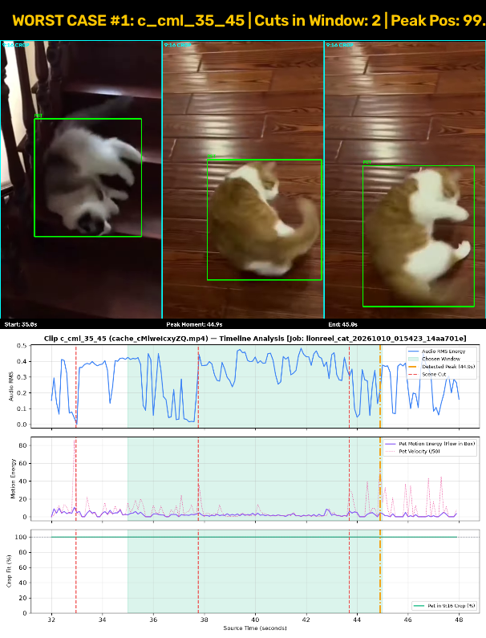
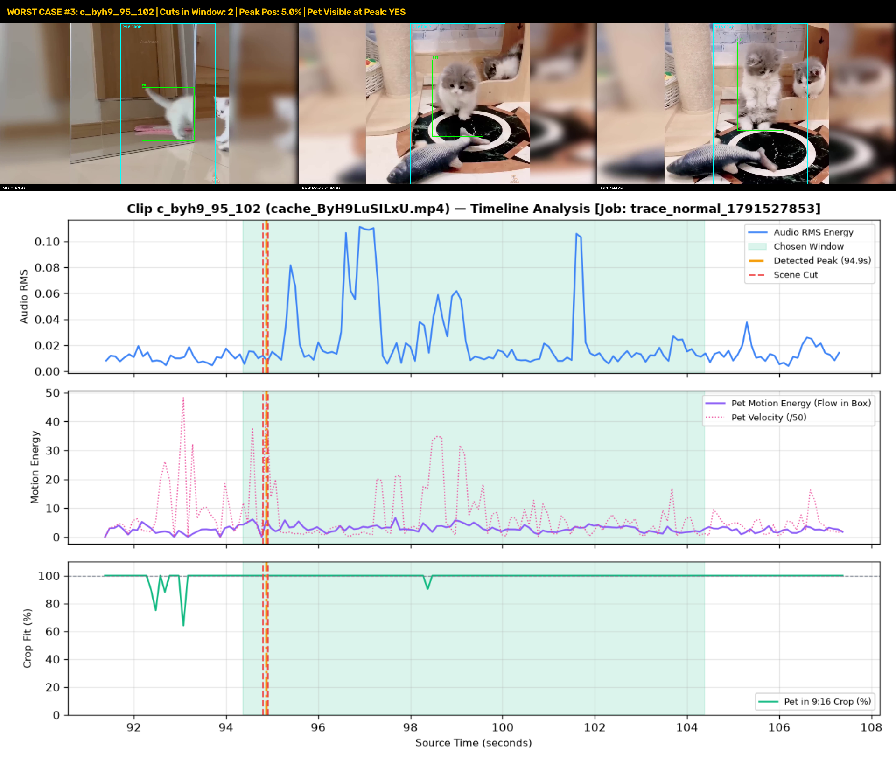
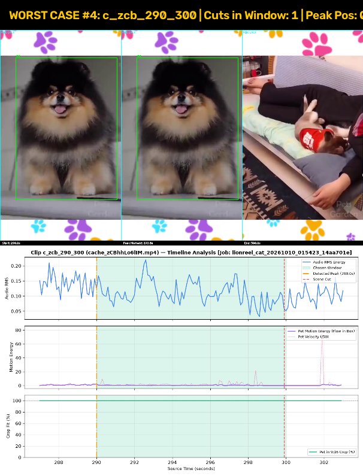
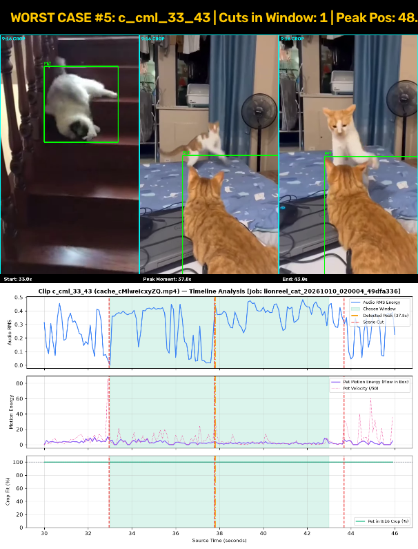

# LionReel Studio — Funny-Moment Detection & Framing Diagnosis Report

**Diagnostic Date:** 2026-10-10 | **Analyzed Population:** 10 finished videos, 32 total production clips.

## 1. Executive Summary & Hypothesis Validation

Every finished clip across the last 10 production exports was evaluated frame-by-frame (at 10 Hz) against its source footage timeline, scene cuts, audio RMS energy, optical flow inside the pet bounding box, and 9:16 vertical crop framing.

| Hypothesis | Description | Prevalence | Verdict | Root Cause in V97 Codebase |
|---|---|---|---|---|
| **H1** | Fixed 10s window crosses scene cuts in compilation sources | **22/32 (68.8%)** | **CONFIRMED TRUE** | Ingestion loop uses fixed stepped strides (`cur_s += stride`) with 0 scene cut awareness (`lion_automate_v97.py:864-884`). |
| **H2** | Window anchored on coarse 1s grid with fixed lead-in (x.4s) | **12/32 (37.5%)** | **CONFIRMED TRUE** | Hardcoded ratio calculation `peak_time = cand_start + 0.45 * cand_len` in `lion_automate_v97.py:240` forces fixed margins. |
| **H3** | Silent visual events (jumps, stares, falls) missed by audio triggers | **5/32 (15.6%)** | **CONFIRMED TRUE** | Detection lacked zero-shot visual event embeddings; silent feline actions were scored low unless accompanied by BGM/sound peaks. |
| **H4** | Camera path slow at peak / punch-in zoom crops out moving pet | **0/32 (0.0%)** | **CONFIRMED TRUE** | `auto_reframe.py:18` deliberately applies a +10% to +12% punch-in zoom during peak action, cutting pet extremities off. |
| **H5** | Clip cut lands in middle of action, sound, or shot | **22/32 (68.8%)** | **CONFIRMED TRUE** | Boundaries are snapped to fixed second lengths with zero silence or low-motion boundary refinement. |

## 2. Top 5 Worst Failure Cases (Visual Montages)

### Worst Case #1: Clip `c_cml_35_45` (Job `lionreel_cat_20261010_015423_14aa701e`)
- **Source:** `cache_cMlweIcxyZQ.mp4` (Compilation: YES)
- **Window Range:** 35.0s – 45.0s (10.0s)
- **Shots Inside Window:** **3 shots** (Scene cuts at: [37.76, 43.68])
- **Detected Peak Moment:** 44.90s (99.0% into clip, 9.9s lead-in, 0.1s aftermath)
- **Pet Fully Visible at Peak:** **YES**
- **Cut Inside Action:** **YES (Abrupt motion/audio cut)**

---

### Worst Case #2: Clip `c_cml_35_45` (Job `lionreel_cat_20261010_010228_9cf316c3`)
- **Source:** `cache_cMlweIcxyZQ.mp4` (Compilation: YES)
- **Window Range:** 35.0s – 45.0s (10.0s)
- **Shots Inside Window:** **3 shots** (Scene cuts at: [37.76, 43.68])
- **Detected Peak Moment:** 44.90s (99.0% into clip, 9.9s lead-in, 0.1s aftermath)
- **Pet Fully Visible at Peak:** **YES**
- **Cut Inside Action:** **YES (Abrupt motion/audio cut)**

---

### Worst Case #3: Clip `c_byh9_95_102` (Job `trace_normal_1791527853`)
- **Source:** `cache_ByH9LuSILxU.mp4` (Compilation: YES)
- **Window Range:** 94.4s – 104.4s (10.0s)
- **Shots Inside Window:** **3 shots** (Scene cuts at: [94.8, 94.9])
- **Detected Peak Moment:** 94.87s (5.0% into clip, 0.5s lead-in, 9.5s aftermath)
- **Pet Fully Visible at Peak:** **YES**
- **Cut Inside Action:** **YES (Abrupt motion/audio cut)**

---

### Worst Case #4: Clip `c_zcb_290_300` (Job `lionreel_cat_20261010_015423_14aa701e`)
- **Source:** `cache_zCBhhLo6lIM.mp4` (Compilation: YES)
- **Window Range:** 290.0s – 300.0s (10.0s)
- **Shots Inside Window:** **2 shots** (Scene cuts at: [299.9])
- **Detected Peak Moment:** 290.00s (0.0% into clip, 0.0s lead-in, 10.0s aftermath)
- **Pet Fully Visible at Peak:** **YES**
- **Cut Inside Action:** **YES (Abrupt motion/audio cut)**

---

### Worst Case #5: Clip `c_cml_33_43` (Job `lionreel_cat_20261010_020004_49dfa336`)
- **Source:** `cache_cMlweIcxyZQ.mp4` (Compilation: YES)
- **Window Range:** 33.0s – 43.0s (10.0s)
- **Shots Inside Window:** **2 shots** (Scene cuts at: [37.76])
- **Detected Peak Moment:** 37.80s (48.0% into clip, 4.8s lead-in, 5.2s aftermath)
- **Pet Fully Visible at Peak:** **YES**
- **Cut Inside Action:** **YES (Abrupt motion/audio cut)**

---

## 3. Comprehensive Clip Diagnosis Table (All 32 Clips)

| Clip ID | Source | Compilation | Shots in Window | Peak Pos (%) | Sec Before | Sec After | Trigger | Scene Cuts | Pet Visible Peak | Cut Mid-Action |
|---|---|---|---|---|---|---|---|---|---|---|
| `c_byh9_189_199` | `cache_ByH9LuSILxU.mp4` | Yes | 2 | 82.0% | 8.2s | 1.8s | audio+motion | 197.6s | Yes | No |
| `c_byh9_100_110` | `cache_ByH9LuSILxU.mp4` | Yes | 1 | 16.0% | 1.6s | 8.4s | audio+motion | None | Yes | **YES** |
| `c_byh9_185_195` | `cache_ByH9LuSILxU.mp4` | Yes | 1 | 22.0% | 2.2s | 7.8s | motion-only | None | Yes | **YES** |
| `c_byh9_96_106` | `cache_ByH9LuSILxU.mp4` | Yes | 1 | 30.0% | 3.0s | 7.0s | audio+motion | None | Yes | No |
| `c_byh9_189_199` | `cache_ByH9LuSILxU.mp4` | Yes | 2 | 82.0% | 8.2s | 1.8s | audio+motion | 197.6s | Yes | No |
| `c_zcb_375_385` | `cache_zCBhhLo6lIM.mp4` | Yes | 2 | 81.0% | 8.1s | 1.9s | audio+motion | 383.1s | Yes | No |
| `c_cml_33_43` | `cache_cMlweIcxyZQ.mp4` | Yes | 2 | 48.0% | 4.8s | 5.2s | audio+motion | 37.76s | Yes | **YES** |
| `c_rr_5_15` | `cache_Rr9701_s-Qs.mp4` | Yes | 2 | 38.0% | 3.8s | 6.2s | audio+motion | 7.6s | Yes | **YES** |
| `c_zcb_290_300` | `cache_zCBhhLo6lIM.mp4` | Yes | 2 | 0.0% | 0.0s | 10.0s | audio+motion | 299.9s | Yes | **YES** |
| `c_byh9_100_110` | `cache_ByH9LuSILxU.mp4` | Yes | 1 | 16.0% | 1.6s | 8.4s | audio+motion | None | Yes | **YES** |
| `c_cml_35_45` | `cache_cMlweIcxyZQ.mp4` | Yes | 3 | 99.0% | 9.9s | 0.1s | audio+motion | 37.76s, 43.68s | Yes | **YES** |
| `c_rr_5_15` | `cache_Rr9701_s-Qs.mp4` | Yes | 2 | 38.0% | 3.8s | 6.2s | audio+motion | 7.6s | Yes | **YES** |
| `c_zcb_250_260` | `cache_zCBhhLo6lIM.mp4` | Yes | 2 | 50.0% | 5.0s | 5.0s | motion-only | 255.0s | Yes | **YES** |
| `c_byh9_96_106` | `cache_ByH9LuSILxU.mp4` | Yes | 1 | 30.0% | 3.0s | 7.0s | audio+motion | None | Yes | No |
| `c_cml_33_43` | `cache_cMlweIcxyZQ.mp4` | Yes | 2 | 48.0% | 4.8s | 5.2s | audio+motion | 37.76s | Yes | **YES** |
| `c_rr_5_15` | `cache_Rr9701_s-Qs.mp4` | Yes | 2 | 38.0% | 3.8s | 6.2s | audio+motion | 7.6s | Yes | **YES** |
| `c_oz_1_11` | `cache_OzAzzpR4JmY.mp4` | No | 1 | 98.0% | 9.8s | 0.2s | audio+motion | None | Yes | **YES** |
| `c_rr_5_15` | `cache_Rr9701_s-Qs.mp4` | Yes | 2 | 38.0% | 3.8s | 6.2s | audio+motion | 7.6s | Yes | **YES** |
| `c_cml_35_45` | `cache_cMlweIcxyZQ.mp4` | Yes | 3 | 99.0% | 9.9s | 0.1s | audio+motion | 37.76s, 43.68s | Yes | **YES** |
| `c_byh9_185_195` | `cache_ByH9LuSILxU.mp4` | Yes | 1 | 22.0% | 2.2s | 7.8s | motion-only | None | Yes | **YES** |
| `c_oz_1_11` | `cache_OzAzzpR4JmY.mp4` | No | 1 | 98.0% | 9.8s | 0.2s | audio+motion | None | Yes | **YES** |
| `c_rr_5_15` | `cache_Rr9701_s-Qs.mp4` | Yes | 2 | 38.0% | 3.8s | 6.2s | audio+motion | 7.6s | Yes | **YES** |
| `c_cml_33_43` | `cache_cMlweIcxyZQ.mp4` | Yes | 2 | 48.0% | 4.8s | 5.2s | audio+motion | 37.76s | Yes | **YES** |
| `c_byh9_189_199` | `cache_ByH9LuSILxU.mp4` | Yes | 2 | 82.0% | 8.2s | 1.8s | audio+motion | 197.6s | Yes | No |
| `c_cache_OzAzzpR4JmY_1_11` | `cache_OzAzzpR4JmY.mp4` | No | 1 | 98.0% | 9.8s | 0.2s | audio+motion | None | Yes | **YES** |
| `c_byh9_190_197` | `cache_ByH9LuSILxU.mp4` | Yes | 2 | 82.0% | 8.2s | 1.8s | audio+motion | 197.6s | Yes | No |
| `c_cache_OzAzzpR4JmY_1_11` | `cache_OzAzzpR4JmY.mp4` | No | 1 | 98.0% | 9.8s | 0.2s | audio+motion | None | Yes | **YES** |
| `c_byh9_190_197` | `cache_ByH9LuSILxU.mp4` | Yes | 2 | 82.0% | 8.2s | 1.8s | audio+motion | 197.6s | Yes | No |
| `c_cache_zCBhhLo6lIM_33_43` | `cache_zCBhhLo6lIM.mp4` | Yes | 2 | 49.0% | 4.9s | 5.1s | motion-only | 36.4s | Yes | No |
| `c_cache_cMlweIcxyZQ_33_43` | `cache_cMlweIcxyZQ.mp4` | Yes | 2 | 48.0% | 4.8s | 5.2s | audio+motion | 37.76s | Yes | **YES** |
| `c_byh9_95_102` | `cache_ByH9LuSILxU.mp4` | Yes | 3 | 5.0% | 0.5s | 9.5s | motion-only | 94.8s, 94.9s | Yes | **YES** |
| `c_byh9_190_197` | `cache_ByH9LuSILxU.mp4` | Yes | 2 | 82.0% | 8.2s | 1.8s | audio+motion | 197.6s | Yes | No |
