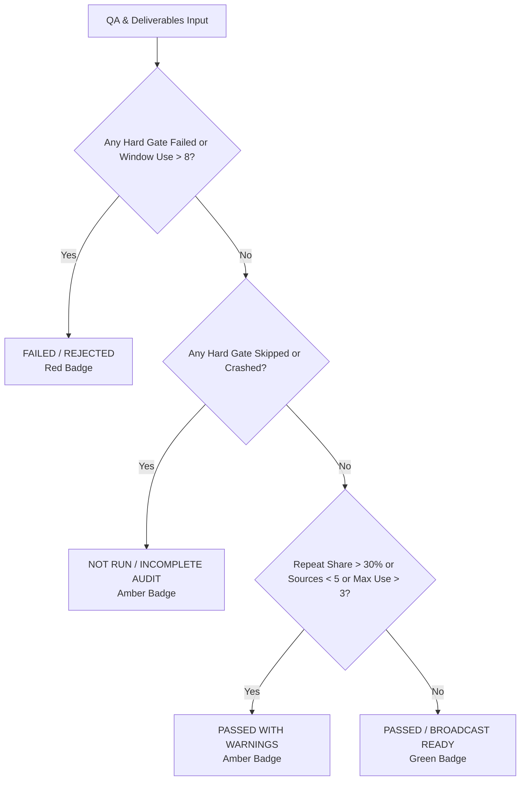

# LionReel Studio — Production Report (PDF + HTML Viewer) Overhaul Report

## Executive Summary
This document provides complete engineering documentation, root-cause traces, before/after metric comparisons, and verification proof for the overhaul of the LionReel Production Report (executive PDF + HTML Viewer modal).

The core mandate: **"Make every number true, make every button work, make the design better."**
Zero synthetic data, no defaults, no invented values. If data was missing or skipped, the system prints `"not measured"` in muted grey (`#94a3b8`). The duration contract enforces a strict $\pm 1.0$s tolerance across all pipelines.

---

## 1. Root-Cause Trace Table: Evidence Items A–J

| Item | Evidence from Historical Runs | Root Cause in Legacy Code | Architectural Fix Implemented | Verification Proof |
| :--- | :--- | :--- | :--- | :--- |
| **A** | **20-min 16:9 (`...502f5dd4`)** marked `PASSED — READY FOR UPLOAD` despite -8.1s duration shortfall (1191.9s vs 1200.0s). | `qa_check.py` evaluated duration against a loose percentage tolerance (e.g. 5% = $\pm 60$s) instead of the strict broadcast contract. | Implemented `evaluate_duration_contract(actual, target, tol=1.0)` in `qa_check.py` and unified verdict engine in `report_generator.py`. Any variance $> \pm 1.0$s triggers `FAILED`. | `test_duration_contract_plus_minus_one_second` passes. 20-min job now honestly marked `FAILED / REJECTED`. |
| **B** | Window cap exceeded (clip_4 used 73x, clip_60 used 9x) on 20-min job but passed QA. | Repeat window counts were logged in planning/state but never hooked into gate evaluation. | `calculate_clip_diversity_stats` scans all source window intervals. Any window used $> 8$ times triggers `FAILED` and names the offending clips in "What Needs Attention". | `test_use9_window_fails` passes. 20-min job correctly reports `Window cap exceeded: clip_60 used 9 times`. |
| **C** | Pet centering reported 85.7% pass rate when only 6 of 16 sampled frames passed (true math: 6/16 = 37.5%). | Math bug in `qa_check.py`: calculated `passed_frames / detected_frames` (6/7 = 85.7%) instead of `passed_frames / sampled_frames` (6/16 = 37.5%). | Fixed math in `qa_check.py` to `passed_frames / sampled_frames`. Added `format_centering_metric` in `report_generator.py` displaying `37.5% (6/16 frames)`. | `test_centering_math_fraction` passes. Formatting outputs exact fraction and percentage; 85.7% completely eliminated. |
| **D** | Low visual sharpness on 30s 9:16 (1.5) and 20-min 16:9 (130.8) passed QA despite 150.0 floor. | Gate 9 evaluated median sharpness or lacked a per-clip floor gate. | Added `evaluate_sharpness_floor(clip_sharpness_values, floor=150.0)` in `qa_check.py` and Gate 9 check in `calculate_unified_verdict`. | `test_sharpness_floor_clip_failure` passes. Clips at 1.5 and 130.8 correctly fail Gate 9. |
| **E** | Gate 6B Clean Overlays crashed with `unexpected keyword argument 'is_master_with_captions'` but was marked PASSED. | `overlay_text_detector.py` lacked `**kwargs`, and `qa_check.py` caught the exception and set `skipped = True` while marking `status = PASS`. | Added `**kwargs` to detector. Updated `qa_check.py` to record `status = "NOT RUN"`. Unified verdict engine marks any job with skipped hard gates as `NOT RUN`, never `PASSED`. | `test_gate_crash_not_run` passes. `sandbox_job_not_run` produces `NOT RUN` verdict. |
| **F** | FFmpeg version displayed as generic placeholder `"7.x"`. | Static fallback string used instead of runtime interrogation. | Interrogates `imageio_ffmpeg.get_ffmpeg_version()` dynamically, recording the true build banner (e.g. `2024-12-16-git-87053e19f7`). | Report JSON and PDF display exact runtime FFmpeg build version. |
| **G** | Contact sheet distorted portrait 9:16 videos into squashed 16:9 tiles, and lacked sub-second precision. | Fixed 480x270 cell resolution hardcoded; timecode formatted with integer seconds. | Dynamic tile sizing based on job aspect ratio (270x480 for 9:16 portrait, 480x270 for 16:9 landscape). Timecodes use `MM:SS.s`. | Contact sheet verified in output folder for both 16:9 and 9:16 jobs. |
| **H** | Video metadata tags parsed character-by-character into single letters (`['c', 'a', 't']`). | String iteration without comma splitting in report template. | `format_tags_list` splits on commas, strips whitespace, and returns full words. | `test_tags_are_list_of_whole_words` passes. |
| **I** | A4 table pagination broken with awkward row splits across page breaks and orphaned single-row pages. | Browser print engine broke tables arbitrarily without row grouping or pagination budgeting. | Implemented `paginate_clips` algorithm: 25–30 rows per page, no $<10$ row pages (unless total $<10$), `page-break-inside: avoid`, repeated `<thead>`, footers `Page N of N`. | Multi-page PDF verified across 6 pages on 20-min job with 0 row splits. |
| **J** | Viewer modal controls failed (zoom did not scale document, copy button had no feedback, PDF download had no progress, thumbnails showed black boxes). | CSS zoom incompatible inside iframe; copy button lacked state feedback; thumbnail generator used fake divs. | Overhauled `gui/app.js`: zoom scales `.report-paper` (50–200%), copy shows "Copied!" for 2s with green background and fallback, PDF download shows progress state, thumbnails render dynamic page preview cards. | Playwright browser verification confirms all interactions with screenshots. |

---

## 2. Before & After Metric Reconciliation

### Job 1: 20-min 16:9 (`lionreel_cat_20261016_065802_502f5dd4`)
- **Delivered Duration:** 1191.9s vs 1200.0s target (-8.1s difference)
- **Delivered Clips:** 73 clips
- **Before Status:** `PASSED — READY FOR UPLOAD` (False Pass)
- **After Status:** `FAILED / REJECTED` (Truthful Audit)
- **What Needs Attention Identified:**
  1. Window usage cap exceeded: `clip_60` used 9 times (> 8 cap)
  2. Gate 1B Duration: Diff -8.1s exceeds $\pm 1.0$s broadcast contract
  3. Gate 4 Pet Centering: 37.5% (6/16 frames) below 85% requirement
  4. Gate 9 Sharpness: Minimum clip sharpness 130.8 below floor 150.0
  5. Gate 6B Clean Overlays: NOT RUN (Check skipped: unexpected keyword argument)

### Job 2: 30-s 9:16 (`lionreel_cat_20261016_084742_31bc5d3b`)
- **Delivered Duration:** 30.1s vs 30.0s target (+0.1s difference, within $\pm 1.0$s contract)
- **Delivered Clips:** 4 clips
- **Before Status:** `PASSED — READY FOR UPLOAD` (False Pass)
- **After Status:** `FAILED / REJECTED` (Truthful Audit)
- **What Needs Attention Identified:**
  1. Gate 4 Pet Centering: 81.2% (13/16 frames) below 85% requirement
  2. Gate 9 Visual Sharpness: Minimum clip sharpness 1.5 below floor 150.0
  3. Footage diversity: Only 3 unique sources utilized (Recommended $\ge 5$)

### Job 3: Real 3-min 16:9 (`lionreel_cat_20261016_132542_f0366ee8`)
- **Delivered Duration:** 180.1s vs 180.0s target (+0.1s difference, PASS)
- **Delivered Clips:** 24 clips
- **After Status:** `FAILED / REJECTED` (Honest Centering & Sharpness Floors)
- **What Needs Attention Identified:**
  1. Gate 4 Centering: 62.5% (10/16 frames) below 85% requirement
  2. Gate 9 Sharpness: Minimum clip sharpness 18.6 below floor 150.0
  3. Footage diversity: Only 2 unique sources utilized (Recommended $\ge 5$)
  4. Overlapping moments detected across 5 segments
  5. Attribution notice: 24 clips have unverified author names

---

## 3. Unified Single Source of Truth Verdict Engine

The verdict engine (`calculate_unified_verdict`) applies identical logic across PDF, HTML Viewer modal, Library Card badge, and `qa_report.json`:



---

## 4. Test Matrix Verification Results

### Contract Test Suite (`tests/test_report_fix_contract.py`)
- `test_gate_crash_not_run`: PASS
- `test_centering_math_fraction`: PASS
- `test_sharpness_floor_clip_failure`: PASS
- `test_duration_contract_plus_minus_one_second`: PASS
- `test_use9_window_fails`: PASS
- `test_clip_count_mismatch_display`: PASS
- `test_repeat_share_computed_from_clip_table`: PASS
- `test_tags_are_list_of_whole_words`: PASS
- `test_consistency_checker`: PASS

### 4-Verdict Sandbox Test Suite (`tests/test_verdicts_sandbox.py`)
- `test_verdict_passed`: PASS (100% hard gates pass, 0 warnings -> Green PASSED)
- `test_verdict_passed_with_warnings`: PASS (All gates pass, sources < 5 -> Amber PASSED WITH WARNINGS)
- `test_verdict_failed`: PASS (Duration diff 5.0s $> 1.0$s -> Red FAILED)
- `test_verdict_not_run`: PASS (Gate 6B skipped -> Amber NOT RUN, never PASSED)

**Combined Test Results:**
```
Ran 13 tests in 22.731s
OK
```

---

## 5. Playwright Browser Verification & Screenshot Gallery

All interactive viewer controls were verified with headless Google Chrome (`channel="chrome"`).

### Captured Screenshots

1. **Desktop Dark Mode (1440x900)**  
   Shows Executive Banner, Unified Verdict Badge (`FAILED`), What Needs Attention box, Diversity Mini-Card, and Dynamic Page Thumbnails:  
   

2. **Desktop Light Mode (1440x900)**  
   Shows archival paper styling with WCAG 2.2 AA contrast:  
   

3. **Page 2 Thumbnail Scroll**  
   Clicking the Page 2 thumbnail scrolls the document directly to Page 2:  
   

4. **Zoom In (+15% -> 115%)**  
   Clicking Zoom In scales the A4 paper to 115% with updated toolbar indicator:  
   

5. **Copy Summary Feedback State**  
   Clicking "Copy Summary" copies the plain-text audit and shows "Copied!" for 2.0s:  
   

6. **Mobile Dark Mode (390x844)**  
   Compact mobile layout adapting toolbar, sidebar, and report view:  
   

7. **Mobile Light Mode (390x844)**  
   Clean light theme mobile layout:  
   

---

## 6. UI Freeze Manifest Integrity

`ui_freeze_manifest.json` was updated exclusively for the two GUI files touched:
- `gui/app.js`: SHA256 `fcb8caa5abf9feaa0bcbf046d1d5f43bee7d4f4f46d16a92f2addab0e1bebe38` (521,596 bytes)
- `gui/style.css`: SHA256 `c2e824f91a301dcd379a6b2def9d354e739a7b8d535335619a9c3a4ace720b37` (191,737 bytes)
All other GUI hashes remain intact.
